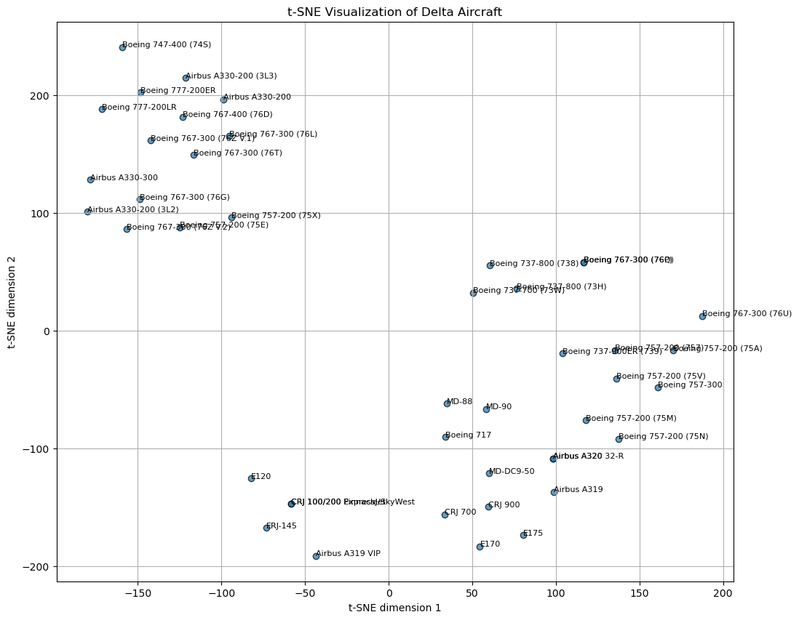
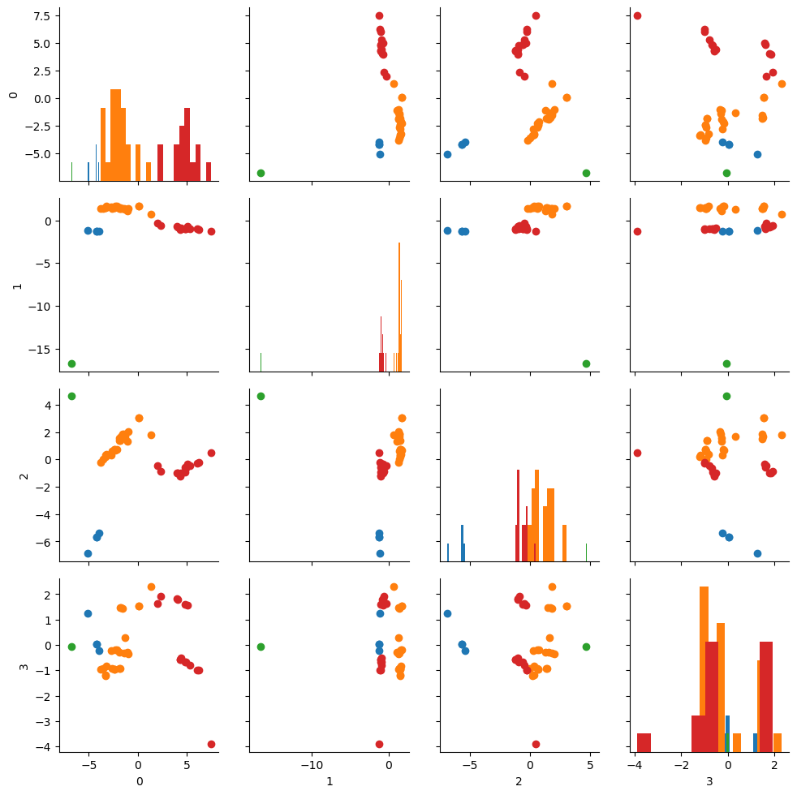
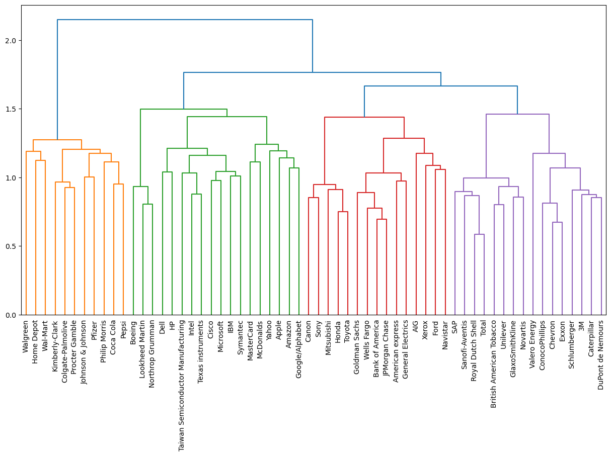

# Unsupervised Learning: Clustering & Dimensionality Reduction

An exploration of unsupervised learning on three real datasets: **Delta Air Lines' aircraft fleet**, the **Iris** flowers and **daily stock-price movements of 60 large companies**. It covers dimensionality reduction (PCA, t-SNE, UMAP) and compares three clustering families (centroid-based **K-Means**, density-based **DBSCAN** and **hierarchical** agglomerative clustering) on data with very different shapes.



---

## Highlights

**PCA is scale-dependent.** On the raw Delta data, the first principal component explains **99.9%** of the variance, but that component is just `Range (miles)`, the feature with the largest numeric scale. After standardizing, the variance spreads out: **4 components explain 85%** and **10 explain 98%**.

**K-Means finds meaningful aircraft segments.** Clustering the 10 retained components (k = 4, chosen with the elbow method) recovers four business-relevant groups without using any labels:

| Cluster | Aircraft | Profile |
|---|:-:|---|
| Long-haul wide-bodies (A330, 747, 767, 777) | 15 | Business + Eco Comfort, **no First Class** |
| Domestic mainline (A319/A320, 737, 757, MD-88…) | 24 | First Class, no Business (one exception) |
| Regional jets (CRJ 100/200, ERJ-145, E120) | 4 | **Economy only** |
| Airbus A319 VIP | 1 | Corporate jet: an outlier in its own cluster |



**No clustering algorithm wins everywhere.** Silhouette scores (DBSCAN scores exclude noise points):

| Dataset | K-Means | DBSCAN | Notes |
|---|:-:|:-:|---|
| Iris (standardized) | 0.459 | 0.549 | DBSCAN labels 38% of points as noise; both confuse *versicolor* and *virginica* |
| Delta PCA components | 0.150 | 0.272 | DBSCAN isolates the VIP jet as noise (9% noise overall) |
| Stock movements (normalized) | 0.036 | 0.088 | DBSCAN leaves 26/60 companies unclustered; hierarchical clustering gives the most interpretable groups |

**Hierarchical clustering explains *how* stocks relate.** The Ward-linkage dendrogram splits the 60 companies into four groups: consumer staples & healthcare (Coca-Cola next to Pepsi, Procter & Gamble next to Colgate), tech & defense, US financials & Japanese manufacturers, and energy & European multinationals. It also shows which companies within a group move most alike.



**t-SNE vs. PCA.** t-SNE separates the fleet into clear local groups (wide-bodies, narrow-bodies, regional jets), while PCA preserves the global structure better and shows how far the A319 VIP is from every other aircraft.

---

## Notebook outline

[`clustering_dimensionality_reduction.ipynb`](clustering_dimensionality_reduction.ipynb)

1. **Dimensionality reduction with PCA**: pair plots of the physical characteristics, naive vs. standardized PCA, explained-variance analysis
2. **K-Means clustering**: elbow method, clusters on the principal components, cluster profiling (seat classes, size, accommodation)
3. **K-Means vs. DBSCAN vs. hierarchical clustering**: Iris, Delta PCA components and stock movements, with k-distance graphs to tune DBSCAN's `eps`, crosstabs and silhouette scores
4. **t-SNE and UMAP vs. PCA** for 2-D visualization of the fleet
5. **Hierarchical clustering of the Delta fleet** (dendrogram)

## Data

| File | Description |
|---|---|
| `data/delta.csv` | 44 Delta aircraft × 33 features: seat width/pitch/count per cabin class, accommodation, cruising speed, range, engines, dimensions, and binary amenity/cabin flags (Wi-Fi, video, power, satellite, flat-bed, sleeper, seat classes) |
| `data/Iris.csv` | Fisher's Iris dataset: 150 flowers, 4 measurements, 3 species ([UCI ML Repository](https://archive.ics.uci.edu/dataset/53/iris)) |
| `data/movements.csv` | Daily stock-price movements for 60 large companies over 963 trading days (Jan 2010 – Oct 2013) |

## Getting started

```bash
pip install -r requirements.txt
jupyter notebook clustering_dimensionality_reduction.ipynb
```

## Tech stack

Python · scikit-learn (PCA, KMeans, DBSCAN, t-SNE, StandardScaler, Normalizer, silhouette score) · SciPy (hierarchical clustering) · umap-learn · pandas · NumPy · Matplotlib · seaborn

---

*Built as part of the Machine Learning I course in my master's program at the University of Chicago.*
